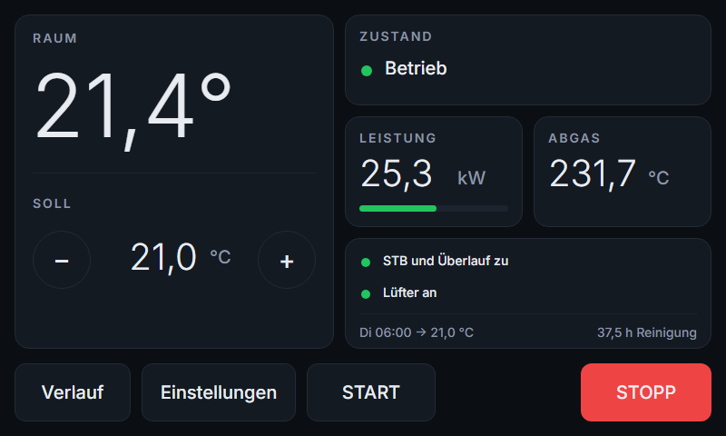
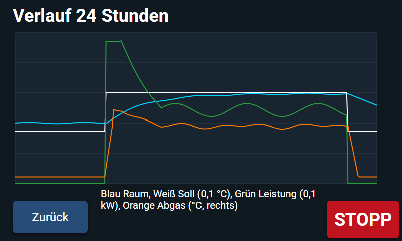
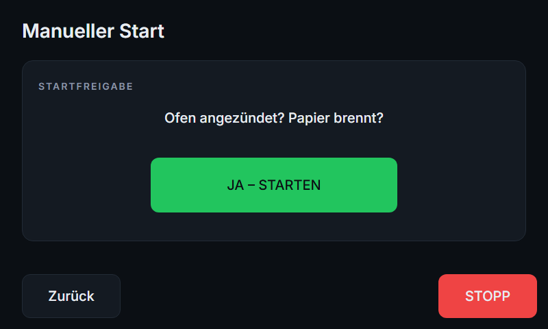
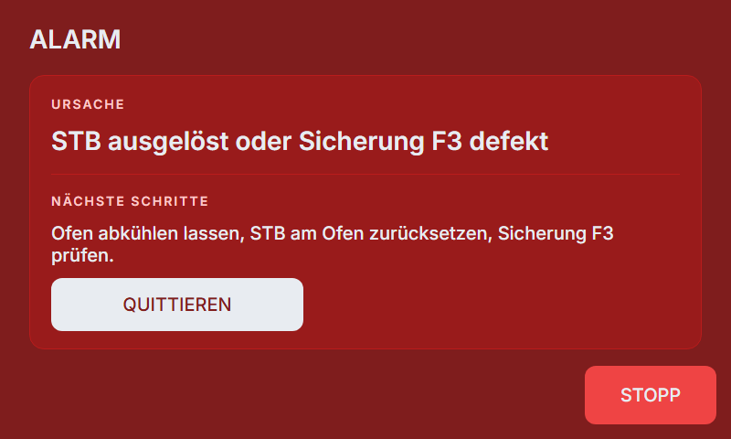

# Steuerung für den Altölofen Master WA 33 C

Selbst gebaute Ofensteuerung auf Basis von [ESPHome](https://esphome.io). Sie ersetzt das originale Steuermodul.
Den vollständigen technischen Auftrag findest du in [docs/CLAUDE.md](docs/CLAUDE.md), Notizen zur Hardware in
[docs/hardware-notes.md](docs/hardware-notes.md).

> **Wichtig:** Der Ofen hat keine automatische Zündung. Die Steuerung startet die Ölpumpe **nie von selbst** –
> nur, wenn ein Mensch am Ofen angezündet und am Display (oder im Webinterface mit Bestätigung) „Start“ gedrückt hat.
> Nach Stromausfall, Neustart oder Alarm steht die Pumpe immer.

## So sieht das Display aus

| Übersicht | Verlauf 24 h |
| --- | --- |
|  |  |
| **Start-Dialog** | **Alarm** |
|  |  |
| **Kalibrierung: Bestätigung Pumpe** | |
|  | |

*Gerenderte Vorschau mit Beispieldaten, keine Fotos vom Gerät: Positionen, Farben und Schriften stammen aus
`ofen-display.yaml`, das echte LVGL-Bild kann in Details abweichen. Neu erzeugen mit
`python docs/screenshots/render.py`.*

## Aufbau in einem Satz

Der **NodeMCU** (Ofen-Controller) misst Sicherheitskette, Lüfter und Abgas und entscheidet allein über die Pumpe.
Das **7-Zoll-Display** ist Bedienteil, Raumregler und Webinterface und schickt dem NodeMCU nur Wünsche.
Der **Funk-Raumfühler** misst die Raumtemperatur und funkt sie per ESP-NOW ans Display.

| Datei | Gerät |
| --- | --- |
| `ofen-controller.yaml` | NodeMCU Amica V2 (ESP8266) im Schaltkasten |
| `ofen-display.yaml` | Waveshare ESP32-S3-Touch-LCD-7 auf dem Schaltkasten |
| `raumfuehler.yaml` | ESP32-C3 Super Mini mit DS18B20 im Wohnraum |
| `components/ofen_logic/` | Steuerlogik (Zustände, Sicherheitsregeln, Protokoll, Regler) – ohne Hardware testbar |
| `components/ofen_link/` | Verbindung Display ↔ NodeMCU über RS485 |
| `test/` | Tests der Steuerlogik am PC |

## 1. Vorbereitung am PC

1. Python 3.11 oder neuer installieren.
2. Im Projektordner:
   ```
   python -m venv .venv
   .venv\Scripts\pip install esphome
   ```
3. `secrets.yaml.example` nach `secrets.yaml` kopieren und ausfüllen: WLAN, Passwörter, ntfy-Topic,
   Transportschlüssel, MAC-Adressen (siehe Abschnitt 4).
4. **Windows-Hinweis:** In der PowerShell kompilieren, nicht in der Git-Bash (ESP-IDF lehnt MSYS ab).
   Liegt der Projektordner in einem Pfad mit Umlauten (z. B. „Ölofensteuerung“), vorher ein Datenverzeichnis
   ohne Umlaute setzen:
   ```
   $env:ESPHOME_DATA_DIR = "C:\esphome-daten"
   ```

## 2. Flashen

Gerät per USB anschließen und:

```
.venv\Scripts\esphome run ofen-controller.yaml
.venv\Scripts\esphome run ofen-display.yaml
.venv\Scripts\esphome run raumfuehler.yaml
```

ESPHome fragt nach dem Anschluss (COM-Port). Spätere Updates gehen per WLAN (OTA, mit Passwort).

**NodeMCU:** Die serielle Schnittstelle gehört dem RS485-Modul, deshalb gibt es dort keine Logs über USB.
Logs siehst du im Webinterface des NodeMCU (`http://ofen-controller.local`) oder mit
`esphome logs ofen-controller.yaml` über WLAN. Zum Flashen per USB das RS485-Modul an TX/RX abziehen.

## 3. Simulationsmodus (Test am Tisch, ohne Ofen)

In `ofen-controller.yaml` oben `sim: "true"` setzen und flashen. Dann:

- wird die Pumpe **nicht angesteuert** (der PWM-Ausgang bleibt aus),
- gibt es im Webinterface des NodeMCU Schalter „Sim: Kette offen“, „Sim: Kammer warm“, einen Schieberegler
  „Sim: Abgas“ und Knöpfe „Sim: Start/Stopp/Quittieren“.

So lässt sich jeder Ablauf durchspielen, z. B.: Start → „Kammer warm“ ein → nach 30 min Betrieb → Abgas auf 50 °C
ziehen → Alarm „Flamme aus“. Oder: im Betrieb Stecker ziehen → nach dem Wiedereinschalten Zustand STOP.

> **Vor dem Einbau am Ofen unbedingt `sim: "false"` setzen und neu flashen!** Im Simulationsmodus ignoriert die
> Steuerung die echten Sensoren.

## 4. Erste Inbetriebnahme Schritt für Schritt

1. **Raumfühler und Display koppeln:** Beide flashen, im Log die WLAN-MAC-Adressen ablesen
   (`esphome logs`, Zeile mit „MAC Address“) und in `secrets.yaml` als `display_mac` und `raumfuehler_mac` eintragen,
   dann beide neu flashen.
2. **WLAN-Kanal festlegen:** ESP-NOW funktioniert nur, wenn Display-WLAN und Raumfühler auf demselben Kanal funken.
   Im Router den 2,4-GHz-Kanal fest auf den Wert von `wifi_channel` in `secrets.yaml` stellen (Standard 1).
3. **NodeMCU ohne Ofen prüfen:** Im Webinterface des NodeMCU nachsehen:
   - „A0 Sicherheitskette“ zeigt bei geschlossenem STB und Überlauf etwa 2,5–2,7 V.
   - Überlaufschalter von Hand öffnen → etwa 1,2–1,5 V, Zustand ALARM „Überlaufschalter offen“.
   - „Abgastemperatur“ zeigt etwa die Raumtemperatur.
   - „Lüfter (Kammer warm)“ ist aus.
4. **Verbindung Display ↔ NodeMCU:** RS485 A–A, B–B, GND–GND verbinden. Das Display zeigt den Zustand STOP;
   ohne Verbindung zeigt es einen Verbindungsfehler.
5. **Pumpe kalibrieren** (Abschnitt 7), bevor der Ofen zum ersten Mal brennt.
6. **Erster Brand:** Ofen wie gewohnt mit Papier anzünden, am Display „Start“ drücken. Die Pumpe läuft auf
   Minimum. Nach 10–15 min schaltet T40 den Lüfter ein (Anlauf). 30 min später beginnt der Regelbetrieb.

## 5. Bedienung

**Am Display:** Die Übersicht zeigt Raumtemperatur, Sollwert (−/+ in 0,5-K-Schritten), Leistungsbalken
17–33 kW, eine farbige Zustandskachel (grau Stop, orange Anzünden/Anlauf mit Restzeit, grün Betrieb, blau
Auslöschen, rot Alarm), Abgas, Sicherheitskette, Lüfter, die nächste Heizzeit und die Betriebsstunden seit der
letzten Tellerreinigung. Der rote **STOPP**-Knopf unten rechts ist auf jedem Bildschirm da. **START** öffnet den
Start-Dialog. Ist Start gerade nicht erlaubt, steht dort der Grund. Bei einem Alarm erscheint ein roter
Vollbildschirm mit Ursache, Handlungsanweisung und Quittier-Knopf.

**Im Webinterface** (`http://ofen-display.local`, Benutzer/Passwort aus `secrets.yaml`): Zustand, Temperaturen,
Sollwert, STOPP. Starten geht dort nur, wenn du vorher den Schalter „Ofen vor Ort angezündet“ einschaltest und
dann „START“ drückst. Der Schalter setzt sich danach selbst zurück.

**Zeitprogramm:** Im Webinterface gibt es pro Wochentag ein Textfeld, z. B.
`06:00-08:00=21 17:00-22:30=21.5` (bis zu 4 Fenster, Sollwert in °C). Leer = ganzer Tag Absenkung
(Standard 12 °C). Das Programm ändert **nur den Sollwert**. Ist der Ofen aus, meldet das Display bei Beginn
einer Heizzeit „Heizzeit beginnt – Ofen anzünden?“ (auch per Push), startet aber nie selbst.

**Push-Nachrichten:** In der App [ntfy](https://ntfy.sh) das Topic aus `secrets.yaml` abonnieren. Nachrichten
kommen bei jedem Alarm, wenn der Raumfühler fehlt und wenn eine Heizzeit beginnt. Abschaltbar über den Schalter
„Push-Nachrichten“.

**Display aus / Aufwecken:** Unter **Einstellungen → Display** (und im Webinterface):

| Einstellung | Wirkung |
| --- | --- |
| Automatisch ausschalten | Beleuchtung nach „Aus nach“ ohne Berührung aus (Standard an) |
| Aus nach | 1, 2, 5, 10, 15, 30 oder 60 min (Standard 10 min) |
| Nachts 30 s, von … bis … Uhr | In diesem Zeitraum schon nach 30 s aus (Standard aus, 22–6 Uhr) |
| An lassen beim Anzünden/Anlauf | Während du den Ofen hochfährst, bleibt das Display an (Standard an) |
| Jetzt aus | Sofort dunkel |

Eine Berührung weckt das Display. Diese Weck-Berührung löst keinen Knopf aus. Ein Alarm schaltet das Display
immer ein. Stufenlos dimmen geht nicht, weil die Beleuchtung dieses Boards an einem digitalen Ausgang des CH422G
hängt und nur an/aus kann.

## 6. Zustände und Alarme

| Zustand | Bedeutung |
| --- | --- |
| STOP | Pumpe aus, Start möglich, wenn Kammer kalt und Sicherheitskette zu |
| ANZUENDEN | Pumpe auf Minimum, wartet bis T40 den Lüfter einschaltet (max. 20 min) |
| ANLAUF | 30 min Minimalleistung, Leistungswünsche werden ignoriert |
| BETRIEB | Regelbetrieb 17–33 kW, Leistung ändert sich höchstens 5 % pro Minute |
| AUSLOESCHEN | Pumpe aus, Lüfter läuft nach, bis die Kammer unter 35 °C ist; dann STOP |
| ALARM | Pumpe aus, Grund wird angezeigt, Quittieren erst wenn Ursache weg und Kammer kalt |
| KALIBRIERUNG_PUMPE | Nur im Kalibrierassistenten, nur bei kalter Kammer, max. 20 min |

| Alarm | Was ist passiert? | Was tun? |
| --- | --- | --- |
| Überlaufschalter offen | Öl im Überlauf | Brenntopf prüfen, Öl entfernen, Überlaufschalter prüfen |
| STB ausgelöst oder Sicherung F3 defekt | Brennkammer über 90 °C oder Sicherung durch | Abkühlen lassen, STB am Ofen zurücksetzen, F3 prüfen |
| Sicherheitskette: Leitungs- oder Bauteilfehler | Spannung an A0 zwischen den gültigen Bereichen | Leitungen und Widerstände R1–R3 prüfen |
| Zündung fehlgeschlagen | 20 min nach Start kein Lüfter (Kammer nicht warm) | Abkühlen lassen, Öl im Topf prüfen, neu anzünden |
| Flamme aus | Abgas unter Grenzwert, stark gefallen, oder in 30 min nach Start nie über 80 °C | Abkühlen lassen, Brennteller reinigen, neu anzünden |
| Abgas-Übertemperatur | Abgas über 450 °C für 60 s | Kalibrierung prüfen, Abgasweg und Thermoelement prüfen |
| Lüfter/T40 meldet aus | Pumpe läuft, aber Lüfter > 60 s aus | Lüfter, T40 und Optokoppler OK1 prüfen |
| Abgassensor ausgefallen | Thermoelement liefert im Anzünden/Anlauf keinen Wert oder zeigt trotz Feuer 5 min lang 0 °C | Thermoelement und MAX6675-Kabel prüfen |

**Warnungen ohne Abschalten** (der Ofen würde sonst ausgehen und könnte nur von Hand neu gestartet werden):

- *Raumfühler fehlt* (> 10 min kein Wert): Leistung geht auf Minimum.
- *Keine Verbindung zum Display* (> 60 s): NodeMCU regelt auf Minimum, LED an D4 blinkt.
- *Abgassensor fehlt im Betrieb*: Minimum; nach 10 min ohne Wert wird kontrolliert ausgelöscht.
- *Raum zu warm*: Raum > Soll + 3 K für 30 min trotz Minimum → kontrolliert auslöschen, kein Neustart.

## 7. Kalibrierung

Die Werte liegen im Flash des NodeMCU und überleben Neustarts. Ablauf am Display unter
**Einstellungen → Kalibrierung** (PIN-geschützt):

1. **Pumpenkennlinie** (Ofen kalt): Ölleitung vom Brenner lösen und in einen Messbecher stecken, bestätigen.
   Die Pumpe läuft nacheinander 5 Stufen je 3 min. Nach jeder Stufe die Menge in ml eingeben. Das Display
   berechnet daraus die PWM-Werte für 17 kW (1,46 kg/h) und 33 kW (2,8 kg/h); Öldichte vorher in den Einstellungen
   setzen (Heizöl 0,85 kg/l, Altöl ca. 0,88–0,90). Erst „Übernehmen“ schickt die Werte an den NodeMCU,
   „Wiederherstellen“ holt die alten zurück. Abbruch ist jederzeit möglich, nach 20 min stoppt die Pumpe von selbst.
2. **Flammenerkennung:** läuft im Regelbetrieb auf Minimum 20 min mit und schlägt als Grenze „Flamme aus“
   60 % des mittleren Abgaswerts vor (mindestens 80 °C).
3. **Regelstrecke:** nach mindestens 60 min stabilem Betrieb auf Minimum springt die Leistung auf 100 %, 90 min
   wird die Raumtemperatur aufgezeichnet. Daraus ergeben sich Kp und Ti des Raumreglers.

Jeder Schritt bricht ab bei Alarm, Raum über 26 °C, mehr als 3 h Laufzeit oder Sensorausfall.
Die Pumpen-PWM-Werte (17/33 kW) nimmt der NodeMCU nur im Zustand STOP an, damit die Leistung im Betrieb nicht springt.
Die Pumpenmessung bricht der NodeMCU zusätzlich selbst ab, wenn die Kammer oder das Abgas warm wird, der Abgassensor ausfällt
oder der Raum über 26 °C hat.

**Andere Widerstände an A0:** Die Standardschwellen in `ofen-controller.yaml` (`a0_*`) passen für 68, 75 und
82 kΩ (gemessen bei 12,0–13,2 V: alles zu 2,3–2,9 V, Überlauf offen 1,15–1,5 V). Nur bei anderen Werten anpassen.

## 8. Funk-Raumfühler: warum `packet_transport` über ESP-NOW

ESPHome bringt mit `packet_transport` (Plattform `espnow`) alles mit: Sensorwerte werden direkt unter ihrer ID
übertragen, verschlüsselt und mit Rolling Code gegen Wiederholung geschützt – ohne eigenen Code und ohne Router.
Die reine `espnow`-Komponente müsste man selbst serialisieren. Für späteren Batteriebetrieb ist in
`raumfuehler.yaml` ein Deep-Sleep-Block vorbereitet (auskommentiert).

## 9. Tests der Steuerlogik

Alle Sicherheitsregeln sind als Tests in `test/test_main.cpp` abgedeckt.

- Linux/macOS: `cd test && make test`
- Windows: `.venv\Scripts\pip install ziglang`, dann `test\run_tests.cmd`

Erwartete Ausgabe: `… Prüfungen, 0 Fehler`.

## 10. Fehlersuche

| Problem | Lösung |
| --- | --- |
| Display zeigt „Keine Verbindung“ | RS485 A/B vertauscht? GND verbunden? Baudrate beidseitig 19200? |
| Raumfühler kommt nicht an | MAC-Adressen und `transport_key` in `secrets.yaml` prüfen, Router-Kanal = `wifi_channel` |
| Start gesperrt | Display zeigt den Grund: Kammer noch warm, Kette offen, Abgas ≥ 80 °C oder Alarm offen |
| Alarm lässt sich nicht quittieren | Kammer muss kalt sein (Lüfter aus) und die Ursache behoben |
| Kompilieren scheitert unter Windows | PowerShell statt Git-Bash, `ESPHOME_DATA_DIR` ohne Umlaute setzen |
